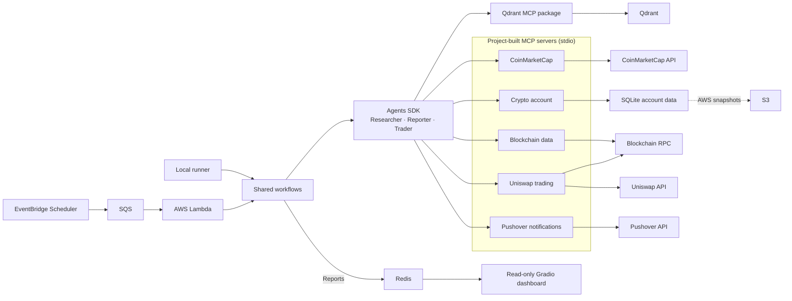

# Crypto Trader by Anton Kovachev

Crypto Trader is a local-testing project for cryptocurrency research, portfolio
reporting, and AI-assisted trading. It uses MCP tools, SQLite account storage,
local Redis, and Qdrant.

Crypto Trader is a Python application for researching digital assets, reporting
on cryptocurrency accounts, and running an AI-assisted trading workflow. It
combines language-model agents with market-data, account, and blockchain tools
served through the Model Context Protocol (MCP). An AWS Lambda handler runs the
trading or reporting workflow. The separate Gradio frontend reads reporter
snapshots from Redis and presents account holdings, portfolio history,
transactions, and activity logs.

The project is an experimental trading and research tool, not financial advice.
Market data may be delayed or incomplete, and model-generated analysis can be
wrong. Trading and token approvals can move or expose real funds. Run it only
with accounts and keys you are prepared to use, and supervise any live trading.

**Source code and full documentation:** [anton-kovachev/crypto_trader](https://github.com/anton-kovachev/crypto_trader)

This contribution is a short project overview; the runnable code, setup
instructions, dependencies, and tests are maintained in the linked repository.

## Configuration files

The project files are not duplicated here, including its runtime, dependency,
and editor configuration (`.env.example`, `.python-version`, `pyproject.toml`,
`uv.lock`, and `.vscode/launch.json`).

The source project's `.env` is not included. To configure a local checkout,
copy its `.env.example` to `.env`. That template describes non-secret settings
for model selection and endpoints, local Redis and Qdrant, SQLite/session
paths, network and token configuration, agent names, and run intervals. It
also identifies integrations that require credentials; no credential values,
passwords, or private keys are included here.

## Architecture and custom MCP servers

The local runner and AWS Lambda invoke the same workflows. The Agents SDK
coordinates researcher, reporter, and trader agents, which call project-built
MCP servers running as stdio subprocesses. Qdrant uses the separately packaged
`mcp-server-qdrant`.

| Custom-built MCP server | Main capabilities | Agents |
| --- | --- | --- |
| CoinMarketCap data | Cryptocurrency lookup and current or historical market listings | Researcher |
| Crypto account | Account management, reports, activity logs, and swap records | Reporter and trader |
| Blockchain data | Wallet, chain, router, gas price, and account nonce | Trader |
| Uniswap trading | Swap quotes, token allowances, and swap transactions | Trader |
| Pushover push | Push notifications | Trader |

### Workflow, step by step

1. **Trigger:** Locally, the runner invokes the shared workflows. In AWS,
   separate configurable EventBridge schedules send trading and reporting
   events through their SQS queues to the backend Lambda.
2. **Research:** The researcher is an AI agent that uses the CoinMarketCap MCP
   server for market data and checks Qdrant for timestamped crypto research
   first. It stores
   reusable findings and portfolio valuation snapshots in Qdrant, helping avoid
   redundant paid market-data requests.
3. **Trade:** The trader is an AI agent that uses the researcher for market
   insights, then accesses the account associated with its configured name. The account MCP server
   manages holdings and records transactions; blockchain and Uniswap MCP
   servers provide network data, quotes, allowance checks, and swap execution.
   Successful swaps update the account's holdings and transaction history.
4. **Report:** The reporter is an AI agent that reads the named account's
   holdings and recent activity, then uses the researcher for current and historical market data
   and Qdrant portfolio snapshots. It calculates portfolio values, P&L, and
   valuation history, and includes activity logs and transactions in its report.
   New valuation snapshots are saved to Qdrant.
5. **Persist:** Account state is stored in SQLite; AWS loads and saves the
   database through S3. After a successful report, the backend stores the
   `ReporterOutput` JSON in Redis, keyed by account name. Redis holds the latest
   report snapshot, not the underlying account database.
6. **Display:** The Gradio dashboard periodically reads report snapshots from
   Redis to visualize holdings, portfolio history, transactions, and activity.
   It is read-only and does not run agents or call MCP servers.

The researcher provides market research to the reporting and trading workflows.
Account data is stored in SQLite; AWS loads and saves its database through S3.
Successful reports are shared with the read-only dashboard through Redis.
